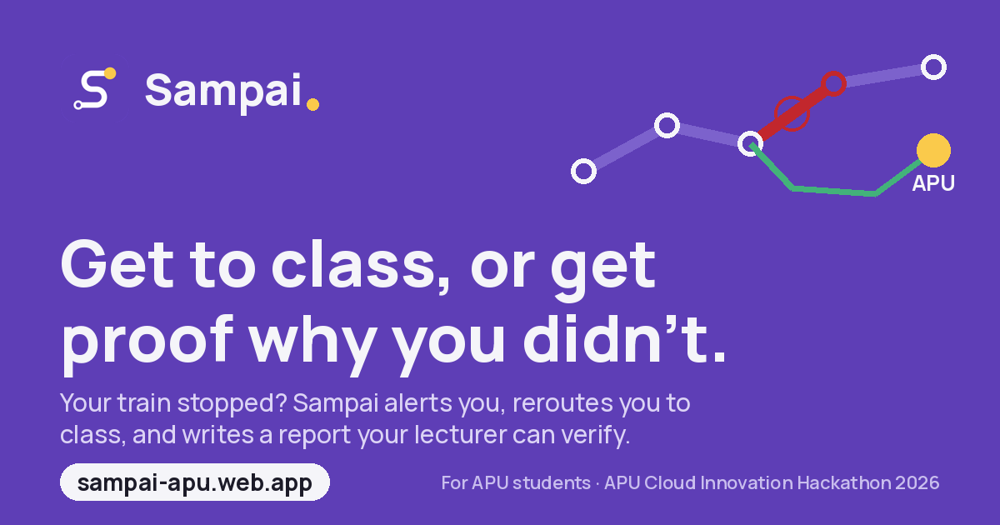

<p align="center">
  
</p>

<h1 align="center">Sampai</h1>

<p align="center"><b>Get to class, or get proof why you didn't.</b></p>

<p align="center">
  <a href="https://sampai-apu.web.app"><b>Live demo</b></a> ·
  <a href="https://sampai-apu.web.app/sim">Simulator</a> ·
  <a href="https://sampai-apu.web.app/admin">Dashboard</a> ·
  <a href="docs/PITCH.md">Pitch brief</a>
</p>

Sampai (Malay for *arrived*) is a commute app that gets APU students to class on public transport. It plans every trip around the student's real APSpace class, compares every way to campus (LRT, Rapid KL bus, the APU shuttle, walking or a taxi), watches the trip with live sources, and when the trip goes wrong anyway, writes a sourced incident report the lecturer can verify.

Built for the **APU Cloud Innovation Hackathon 2026**, challenge: *Smart Campus & Student Experience*.

---

## The problem

Getting to APU on public transport is a daily gamble.

- Students juggle the LRT, Rapid KL buses, the APU shuttle and long walks. No single app knows their **class time**, the **APU shuttle schedule**, or what's going wrong on the way **right now**.
- When a train stalls, a bus is stuck in traffic or a storm hits, students find out too late, with no plan B.
- Arriving late with no record of why means an absence they can't explain.

## What Sampai does

| | |
|---|---|
| **Plans around your class** | Type your intake code. Sampai reads your APSpace timetable and tutorial group, and every option says when to leave and whether it makes class. |
| **Every way to campus** | Train lines (with transfers), the APU shuttle on its real schedule, Rapid KL buses (direct, bus + shuttle, or feeder bus + train), walking and taxi. Real street paths, fares, minutes outdoors, and a recommended pick with the reason. |
| **Live disruption alerts** | Sampai watches your route with Rapid KL live bus GPS, MET Malaysia warnings, weather and riders on board. When something breaks, you get a push with options that still make class. |
| **What to bring** | Umbrella, water, sun protection or a mask, from rain, MET storm warnings, heat, UV and haze, weighted by your minutes outdoors. |
| **Local knowledge** | Fixes maps get wrong, kept in a simple rules file, e.g. a fence that blocks a walking path out of a condo. |
| **Incident report** | A third-person PDF for the lecturer: what happened, according to which source, the student's journey and lateness, and a QR code to the public record. Works with or without an alert, and never claims a cause the records don't show. |
| **Dashboard for APU** | Disruptions by line, hour and weather, worst stretches, and official notes that flow into reports. |
| **Simulator** | Stall a train, jam a bus route, trigger rain, heat or haze, to demo the whole flow. Everything simulated is labelled SIMULATED. |

## Live data, no fake numbers

| Source | Used for |
|---|---|
| APU APSpace | Timetables by intake and group, APU shuttle schedule |
| Prasarana GTFS (data.gov.my) | Rail network, 8 lines and 179 station-to-station stretches |
| Rapid KL bus GTFS + GTFS Realtime (data.gov.my) | 31 bus route patterns near APU, timetables, live bus positions |
| MET Malaysia (data.gov.my) | Storm and heavy rain warnings |
| Open-Meteo (MET Norway fallback) | Rain, heat, UV, air quality |
| OpenStreetMap | Street routing and address search |
| Riders' phones (opt-in) | Train stalls, since trains have no public live feed |

## How it works

```
 phone (web app, PWA)                         backend
 ├─ home, routes, alerts, reports ◄──── Firestore (live state: users, incidents, alerts, conditions)
 ├─ trip pings (opt-in, on board) ──► api ──► Pub/Sub ──► worker
 │                                     │                   ├─ rider stall detection (sliding window per stretch)
 │                                     │                   ├─ Rapid KL bus GPS polling (stuck buses)
 │                                     │                   ├─ MET Malaysia + weather + air quality polling
 │                                     │                   └─ who's affected → Gemini alert → FCM push
 │                                     ├─ route options (APSpace, shuttle, buses, trains, OSRM streets)
 │                                     └─ incident reports (records → Gemini prose → PDF)
```

**Google Cloud and Firebase:** Firebase Hosting (web), Firestore, Firebase Auth (anonymous), Firebase Cloud Messaging, Gemini, and Pub/Sub, Cloud Run, BigQuery and Cloud Scheduler in the Google Cloud deployment (`infra/`). For the hackathon demo the two Node services run on a free host with Pub/Sub swapped for a direct call, which is a config switch with the same code.

**Gemini** writes alerts in English or Bahasa Melayu, picks the best option for the student's class, rain and heat, and writes the report prose from the records only. Every Gemini call has a template fallback, so nothing breaks without it.

## Repository

| Folder | What's in it |
|---|---|
| `web/` | React + Vite + Tailwind PWA: landing, onboarding, home, routes, ride, profile, report, simulator, dashboard, brand kit |
| `api/` | Express: route options, geocoding, APSpace proxy, trip pings, reports (PDF), simulator endpoints |
| `worker/` | Detection, bus and weather polling, alerting, incident logging |
| `shared/` | Types, rail network, time helpers, server clients (Firebase, Gemini, OSRM, APSpace), what-to-bring rules |
| `data/` | `build-segments.ts` turns Prasarana GTFS into rail segments and bus lines; `local_rules.json` holds local fixes |
| `infra/` | Google Cloud setup and Cloud Run deploy scripts |
| `docs/` | Pitch brief, submission summary, deployment handoff |

## Run it locally

Needs Node 20+ and Java (for the Firebase emulators).

```bash
npm install
```

```bash
npm run data
```

```bash
npm run dev
```

That starts the Firestore and Auth emulators, the worker (8081), the api (8080) and the web app (5173). Open http://localhost:5173.

With no Firebase settings everything runs on local emulators (project `demo-sampai`). For Gemini, put an AI Studio key in `api/.env` and `worker/.env` (`GEMINI_API_KEY`); without it, templates take over. Copy each `.env.example` to `.env` and fill in what you need. Never commit `.env` files.

## Deploy

- **Web:** Firebase Hosting at https://sampai-apu.web.app. Settings come from `web/.env.production` (git-ignored). `npx firebase-tools login`, then `npm run deploy:web`. Rules and indexes: `npm run deploy:rules`.
- **api and worker:** `render.yaml` (free plan, step by step in [docs/render-handoff.md](docs/render-handoff.md)), or Cloud Run with the `Dockerfile`s and `infra/deploy.sh` on the Blaze plan.

## Privacy

Anonymous sign-in: no student ID or email. Trip location is shared only when a student opts in, only during the trip, and stops at the destination or after 90 minutes. Raw locations aren't stored. "Recently used" profile values stay in the browser.

## Status and limits

A working prototype. Timetables, shuttle times, bus GPS, weather and air quality are live; simulated riders and incidents are always labelled SIMULATED. Train ride times between stations and fares are estimates. On the web, trip sharing runs while the app is open; a native wrapper with background location is next, followed by planning the trip home after the last class.
